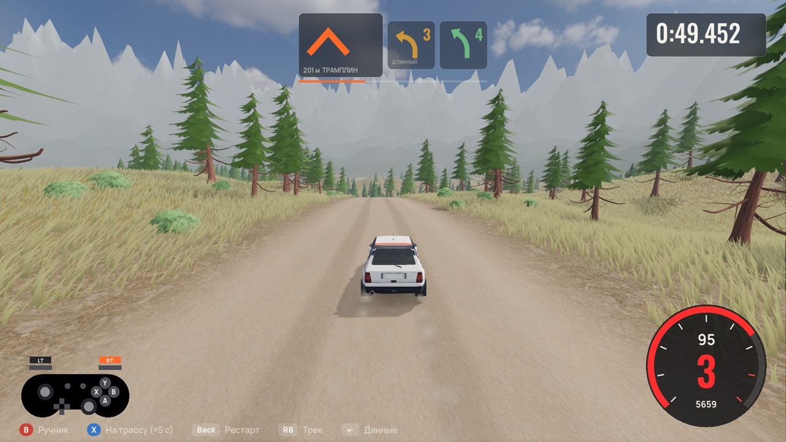
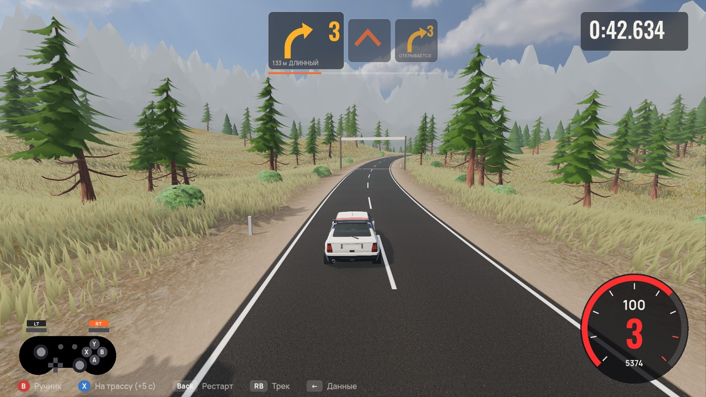
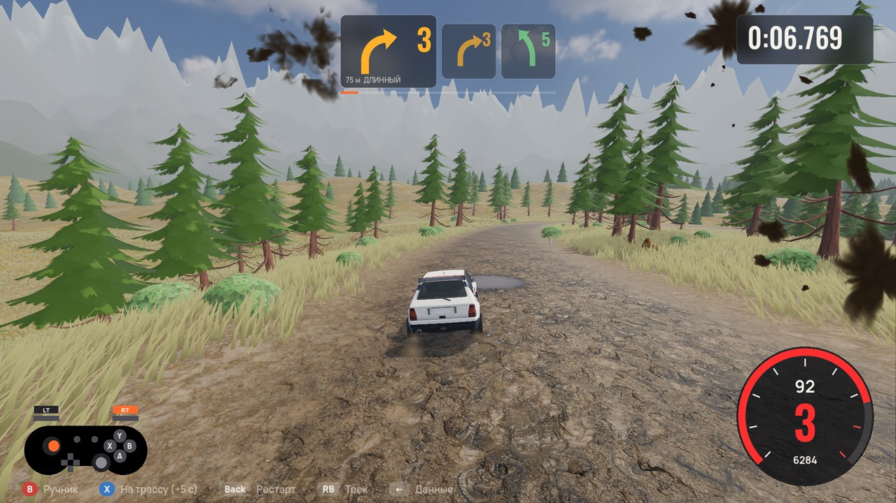
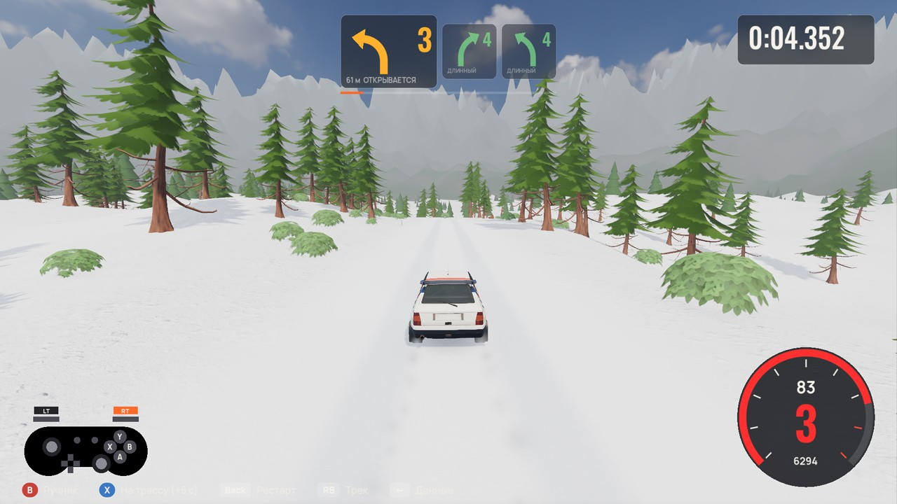
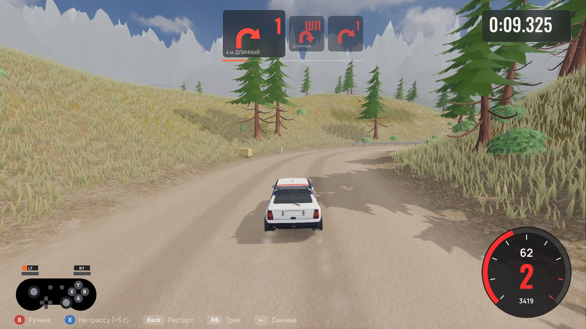
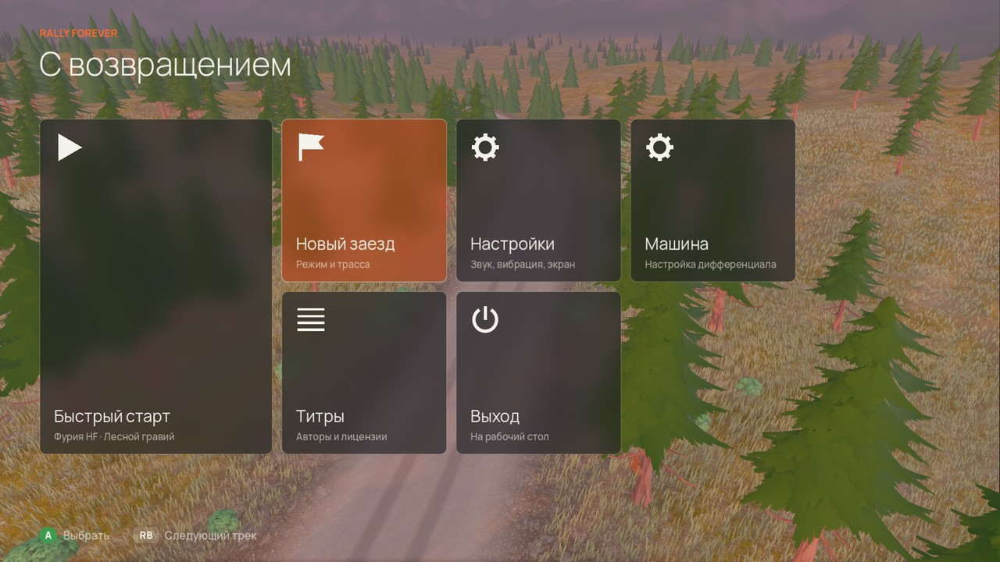
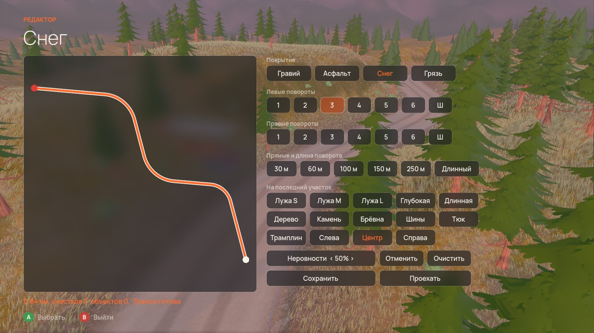

# Rally Forever

Ралли-игра для Windows: заезды на время по гравию, асфальту, грязи и снегу, ралли-кросс и редактор трасс. Игра в разработке.

**[Смотреть трейлер (mp4, 29 секунд)](https://github.com/tenyyq/rally-forever/releases/download/trailer/rally-forever-trailer.mp4)**

| | |
|---|---|
|  |  |
|  |  |
|  |  |

## Что в игре

- Спецучастки на время со стенограммой штурмана
- Ралли-кросс на круги с отбойниками и трамплинами
- Редактор трасс: повороты по цифрам стенограммы, четыре покрытия, лужи и препятствия
- Кооператив на одном экране и гонка по локальной сети
- Настройка дифференциала и главной пары

## Благодарности

Модель автомобиля основана на работе [FREE Lancia Delta HF Integrale evo 2](https://sketchfab.com/3d-models/free-lancia-delta-hf-integrale-evo-2-85614131e0dc4613a948472aaa935fc7), автор TARANTULA (begemot.988888), лицензия [CC BY 4.0](https://creativecommons.org/licenses/by/4.0/). Изменения: удалены логотипы и номера, заменена раскраска, уменьшены текстуры.

Весь остальной контент защищён авторским правом. Исходный код игры в этом репозитории не публикуется.
