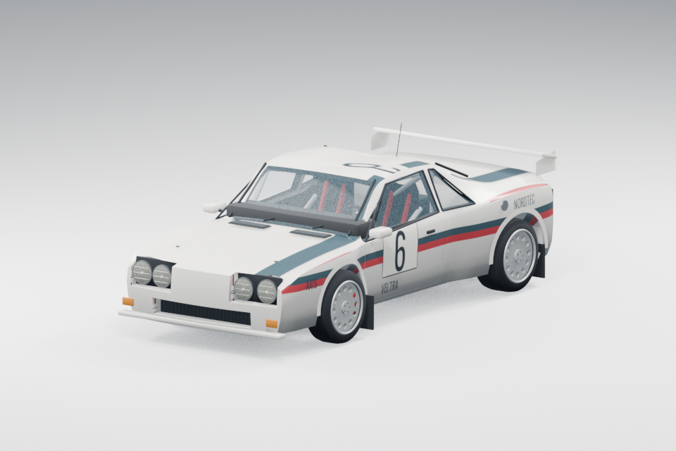
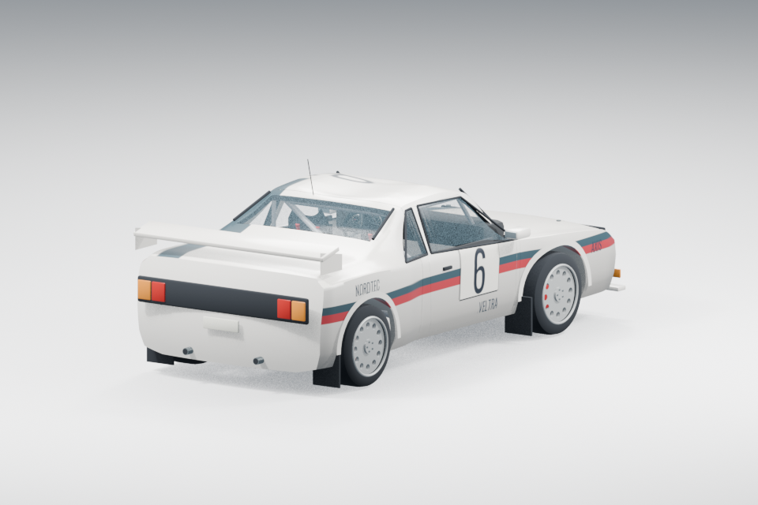

## В разработке: Lince 037

Новая заднеприводная машина по мотивам раллийной 037 сезона 1983. Отдельные кузовные кожухи и двери, салон, подвеска, светотехника. Ниже студийные рендеры Blender первой версии модели, не игровые кадры. Импорт и компиляция выполнены; игровая проверка ещё не проводилась. В доступный релиз 0.11.0-dev эта машина пока не входит.

<!-- current-preview -->
## Актуальная тестовая сборка — 0.11.0-dev

[Скачать для Windows](https://github.com/tenyyq/rally-forever/releases/tag/v0.11.0-dev)

В текущей версии доступна Tern GT4. Начата детализированная переделка окружения 13 локаций: собственная растительность, материалы, здания и ограждения. Работа продолжается; новые локации ещё требуют игровой проверки. Сборка опубликована без автотестов для ручного тестирования.

Предыдущие разделы и скриншоты ниже описывают исторические версии; их автопарк и внешний вид могут отличаться.
<!-- /current-preview -->

# Rally Forever

Ралли-игра для Windows: заезды на время по гравию, асфальту, грязи и снегу, ралли-кросс и редактор трасс. Игра в разработке.

**[Скачать игру для Windows (144 МБ)](https://github.com/tenyyq/rally-forever/releases/download/v0.9.0/RallyForever-0.9.0-windows.zip)** — ранняя тестовая версия.

**[Смотреть трейлер (mp4, 29 секунд)](https://github.com/tenyyq/rally-forever/releases/download/trailer/rally-forever-trailer.mp4)**

| | |
|---|---|
|  |  |
|  |  |
|  |  |

## Что в игре

- 18 машин с разным приводом, массой и прижимной силой
- Спецучастки на время со стенограммой штурмана
- Ралли-кросс на круги с отбойниками, трамплинами и прыжком через разлом
- Редактор трасс: повороты по цифрам стенограммы, четыре покрытия, лужи и препятствия
- Кооператив на одном экране и гонка по локальной сети с никами и тегами
- Настройка каждой машины: дифференциал, главная пара, тормоза и ручник
- Механическая или автоматическая коробка, свои назначения управления

## Благодарности

Участник проекта: [stiiky_](https://github.com/pmnkhn).

Модель автомобиля основана на работе [FREE Lancia Delta HF Integrale evo 2](https://sketchfab.com/3d-models/free-lancia-delta-hf-integrale-evo-2-85614131e0dc4613a948472aaa935fc7), автор TARANTULA (begemot.988888), лицензия [CC BY 4.0](https://creativecommons.org/licenses/by/4.0/). Изменения: удалены логотипы и номера, заменена раскраска, уменьшены текстуры.

Весь остальной контент защищён авторским правом. Исходный код игры в этом репозитории не публикуется.

### Retro Rally 0.9.0
Восемь новых машин в стиле конца 90-х; отдельные настройки, полный, передний и задний привод. [Скачать актуальную сборку](https://github.com/tenyyq/rally-forever/releases/tag/v0.9.0).
