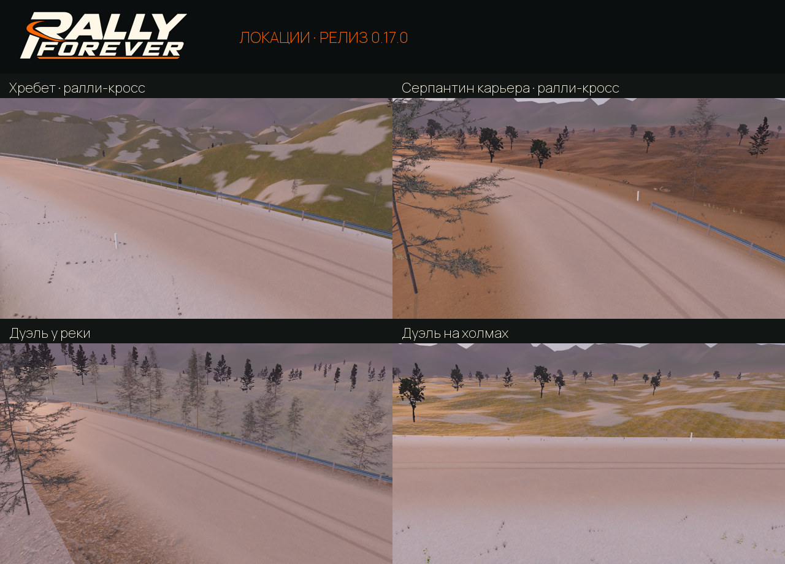

# Rally Forever

Ралли-игра для Windows на Godot: спецучастки на время, ралли-кросс, встречные дуэли, локальная сеть и кооператив на одном компьютере. Проект продолжает развиваться.

## Актуальная версия — 0.17.0

**[Скачать Rally Forever для Windows x64](https://github.com/tenyyq/rally-forever/releases/download/v0.17.0/RallyForever-0.17.0-windows.zip)** · [Описание релиза](https://github.com/tenyyq/rally-forever/releases/tag/v0.17.0)

Распакуйте весь архив и запустите `RallyForever.exe`. Папка `licenses` должна оставаться рядом. Для LAN обоим игрокам нужна одинаковая версия. Первая загрузка может включать компиляцию шейдеров.

## Что изменилось

- 18 автомобилей с индивидуальными приблизительными игровыми параметрами двигателя, привода, массы, развесовки, передач и аэродинамики. Прежняя единственная Фурия заменена новым паком.
- Регулировка демпфирования амортизаторов: отдельные настройки машин, карьерные диапазоны и независимые настройки онлайн.
- Пересобрана общая геометрия 18 исходных карт, исправлены найденные щели и стыки дороги с рельефом. Спецучастки уже и меняются по ширине; кольца и дуэли остаются широкими.
- Доведены «Хребет», «Серпантин карьера», «Дуэль у реки» и «Дуэль на холмах». Обновлены деревья/LOD, лесные группы и размещение объектов.
- Подготовлена стартовая площадка на 12 мест без изменения сетевого лимита. «Весенняя распутица» скрыта из нового выбора, прежняя история сохранена.
- Исправлено сохранение выбранной строки и прокрутки меню. Обновлено 54 игровых превью.

## В игре

- Гравий, асфальт, грязь и снег; регионы, сезонное оформление и окружение Poly Haven.
- Спецучастки со стенограммой, ралли-кросс, встречная дуэль, полигон; сохранённые пользовательские маршруты.
- Механическая и автоматическая коробки, отдельное сцепление, настройка дифференциалов, тормозов, главной пары и амортизаторов.
- Колея на рыхлых покрытиях, небольшой физический эффект колеи и передача её состояния от сетевого хоста. Чистый салон и зимний налёт.
- Карьера: апгрейд за первое чистое прохождение пары «трасса + машина», без повторной награды. Диапазоны отдельных настроек открываются ступенями 15% → 40% → 70% → 100%.
- Онлайн имеет отдельные настройки и полные диапазоны независимо от карьеры.
- Геймпад/клавиатура, переназначение управления, оверлеи, настройки камеры и HUD. Гараж использует автомобиль в сцене меню.
- Настройки дальности деревьев, объектов и травы, плотности травы, упрощённых деревьев, теней и SSAO.

## Проверки и ограничения

Новый exe 0.17.0 собран локально **без дополнительных запусков и тестов бинарника**, по выбору владельца. Перед сборкой выполнены точечные проверки исходников: 18 топологий карт, 51 проверка загрузки/коллизий/меню и 6 полных проездов новых схем без восстановлений. Это не полный игровой автотест и не подтверждение Wi-Fi на разных компьютерах.

Характеристики машин приблизительные, не заводские измерения. Колея использует упрощённую дорожную модель; статическая коллизия кузова не деформируется. Реальные контроллеры/рули и звук на слух в этом этапе не проверены. Открыты отдельные проблемы зимних ботов и ложных сообщений о пропуске контрольных точек. Художественная доводка и оптимизация на разном оборудовании продолжаются; гарантии FPS не заявляются.

## Авторы и лицензии

Участник проекта: [stiiky_](https://github.com/pmnkhn).

Модели текущего автопарка: [1965–2002 Rally Cars — DisneyCars (supercarmodels)](https://sketchfab.com/3d-models/1965-2002-rally-cars-2146acc1e3de409baf46d03a070d0526), заявленная источником [CC BY 4.0](https://creativecommons.org/licenses/by/4.0/). Изменены материалы, структура и точки вращения колёс, текстуры; добавлены игровые параметры, свет и превью. Первичное происхождение моделей независимо не подтверждено. Автор не заявляет поддержку проекта.

В предыдущих сборках использовалась [FREE Lancia Delta HF Integrale evo 2](https://sketchfab.com/3d-models/free-lancia-delta-hf-integrale-evo-2-85614131e0dc4613a948472aaa935fc7), автор TARANTULA (begemot.988888), CC BY 4.0. В 0.17.0 эта модель исключена из экспорта.

Музыка: Of Far Different Nature — Rush, Crypt, Another Step Back, Ritual; [альбом](https://fardifferent.bandcamp.com/album/another-step-back), CC BY 4.0. Stomper / Ripped Apart — Tricks & Traps, [источник](https://opengameart.org/content/free-rhythm-game-music-pack-2), CC0. Полные сведения об авторах, лицензиях и изменениях включены в дистрибутив и игровые титры.

Исходный код игры, внутренние инструкции и профили в этом публичном репозитории не публикуются. Предыдущие версии сохранены в [Releases](https://github.com/tenyyq/rally-forever/releases).
