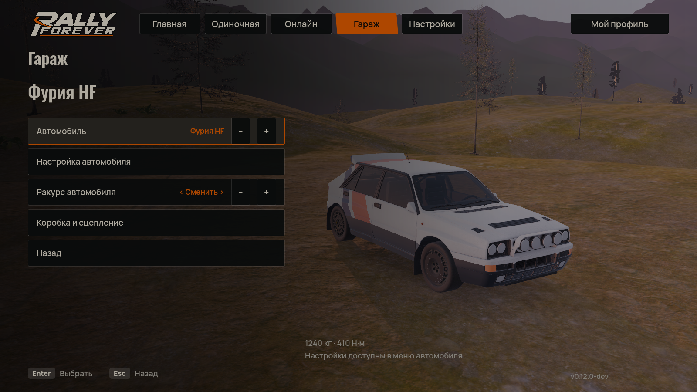
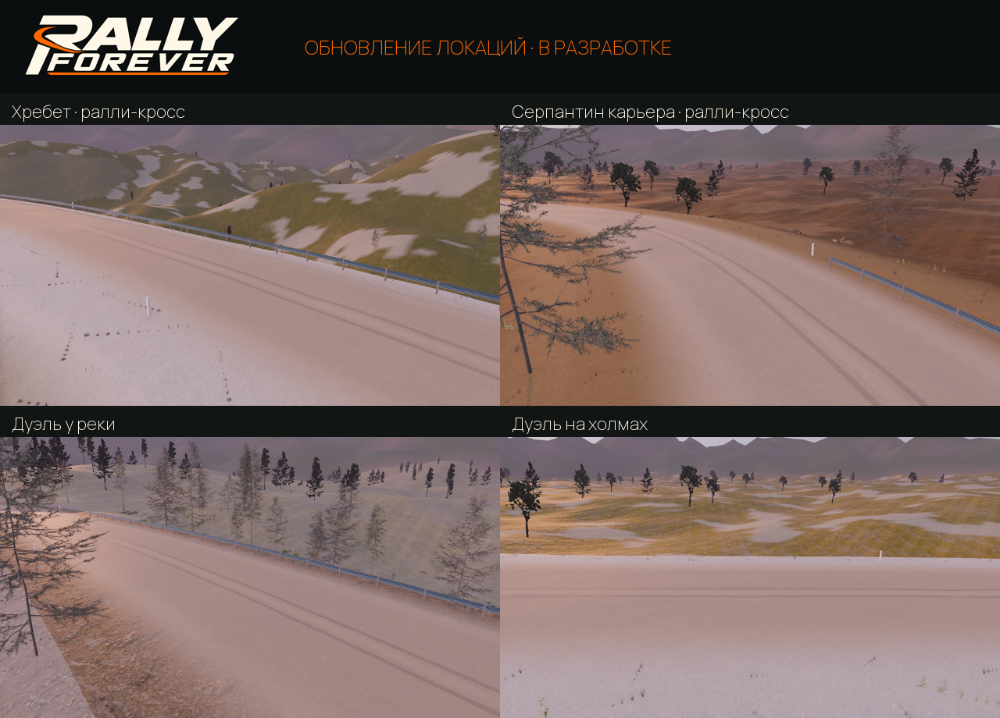

# Rally Forever

Ралли-игра для Windows на Godot: спецучастки на время, ралли-кросс, встречная дуэль, игра по локальной сети и кооператив на одном экране. Проект в разработке.

## Актуальная сборка — 0.16.0-dev

**[Скачать Rally Forever для Windows x64](https://github.com/tenyyq/rally-forever/releases/download/v0.16.0-dev/RallyForever-0.16.0-dev-windows.zip)** · [Описание релиза](https://github.com/tenyyq/rally-forever/releases/tag/v0.16.0-dev)

Распакуйте весь архив и запустите `RallyForever.exe`. Для LAN обоим игрокам нужна одинаковая версия. Лицензии включены в папку `licenses` и в игровые титры.

### Что нового в 0.16

- Накопительная дорожная колея на грунте, грязи и снегу с небольшим физическим влиянием и состоянием от хоста.
- Чистые внутренние материалы автомобиля и белый зимний налёт; на раскатанном снегу виден грунт.
- Подготовленные данные и чанки ускоряют загрузку; отдельные дальности деревьев/объектов/травы, плотность травы, простые деревья, тени и SSAO.
- На высоком пресете дальность травы300м, настройка до350м. Новых автомобилей нет.

### Также в текущей версии

- Обновлённые главное меню, профиль, гараж и настройки в цветах логотипа.
- Единственная игровая машина — **Фурия HF**; гараж показывает существующий автомобиль в сцене меню с выбором ракурса.
- Отдельное сцепление, помощь сцепления, переназначение и клавиатурный оверлей.
- Настройки высоты, дистанции и скоростного отдаления камеры, отдельные переключатели HUD.
- Более хаотичная грязь на кузове.
- Карьера: один апгрейд за первое прохождение пары «трасса + машина» без восстановлений. Повторная награда не выдаётся.
- Апгрейды открывают диапазоны отдельных настроек: 15% → 40% → 70% → 100%. Мощность автоматически не увеличивается.
- Онлайн использует отдельные настройки и полный диапазон для всех независимо от карьеры.
- Включены изменения локальной версии 0.12: инфраструктура, рабочие фары, прогресс спецучастка, сетевое ралли с очередью старта и встречная дуэль 1×1.

### Что уже есть

- Гравий, асфальт, грязь и снег; регионы и сезонное оформление с окружением Poly Haven.
- Спецучастки со стенограммой, кольцевые заезды, полигон и сохранённые пользовательские трассы.
- Механическая и автоматическая коробки, дифференциалы, тормоза и главная пара.
- Поддержка геймпада и клавиатуры, локальная сеть, ники и теги.

### Статус проверки

Новый exe собран локально **без запуска и тестов бинарника** по выбору владельца. До сборки:60 точечных проверок покрытий/материалов/настроек,74 проверки кэшей геометрии и18 сетевых проверок в двух процессах одного ПК. Это не полный игровой автотест и не Wi-Fi двух компьютеров.

В двух фиксированных сценах на RTX2080 при1280×720 создание сцен ускорилось примерно на40–44%. При сопоставимой графике время кадра близко к исходному: прирост FPS не обещается.

Колея — упрощённая модель дорожного коридора; опоры лучевых колёс используют поле, статический collider кузова не деформируется. Смешанные салонные материалы полностью чистые, вместе с ними часть наружного пластика. **Открыто:** зимние боты, возможные ложные пропуски контрольных точек, модели/LOD деревьев. Эти задачи не исправлены этой версией.

Настоящий контроллер, звук на слух и Wi-Fi двух компьютеров не проверены. Сейчас доступно8 карьерных наград на текущую машину, для полного открытия6 настроек нужно18; дальнейшая прогрессия зависит от будущего контента.

## Кадры разработки интерфейса

Кадры интерфейса предыдущей версии из Godot; это не фотографии реальных автомобилей и не макеты вместо рабочего UI.

[Ранний трейлер — предыдущие версии, MP4](https://github.com/tenyyq/rally-forever/releases/download/trailer/rally-forever-trailer.mp4)

## Благодарности и лицензии

Участник проекта: [stiiky_](https://github.com/pmnkhn).

Модель автомобиля: [FREE Lancia Delta HF Integrale evo 2](https://sketchfab.com/3d-models/free-lancia-delta-hf-integrale-evo-2-85614131e0dc4613a948472aaa935fc7), автор **TARANTULA (begemot.988888)**, [CC BY 4.0](https://creativecommons.org/licenses/by/4.0/). Изменения: удалены логотипы и номера, изменены ливрея и размеры текстур, адаптированы материалы, колёса, подвеска и свет. Автор не связан с проектом и не заявляет его поддержку.

Окружение: [Poly Haven](https://polyhaven.com/), [CC0](https://polyhaven.com/license); полный список и остальные лицензии находятся в дистрибутиве. Исходный код игры и внутренние инструкции в этом публичном репозитории не публикуются. История предыдущих релизов сохранена в разделе Releases.

Новая музыка: Of Far Different Nature — Rush, Crypt, Another Step Back, Ritual; [альбом](https://fardifferent.bandcamp.com/album/another-step-back), [CC BY 4.0](https://creativecommons.org/licenses/by/4.0/), файлы без изменений, громкость и переходы в игре. Stomper / Ripped Apart — Tricks & Traps, [источник](https://opengameart.org/content/free-rhythm-game-music-pack-2), CC0, конвертация WAV → Ogg Vorbis. Остальные авторы — в дистрибутиве.
## Подготовлено для следующей сборки

В версии разработки добавлены 18 автомобилей с разными игровыми настройками двигателя, привода, развесовки и аэродинамики, а также регулировка демпфирования амортизаторов. Характеристики приблизительные и не заявляются как заводские измерения. Прежняя единственная модель исключена из будущей сборки.

Эти изменения пока не входят в скачиваемую 0.16.0-dev: новая сборка ещё не опубликована.

Модели: [1965–2002 Rally Cars — DisneyCars (supercarmodels)](https://sketchfab.com/3d-models/1965-2002-rally-cars-2146acc1e3de409baf46d03a070d0526), заявленная лицензия [CC BY 4.0](https://creativecommons.org/licenses/by/4.0/). Для игры изменены материалы, структура колёс и точки вращения; добавлены игровые параметры и превью. Подтверждение первичного происхождения моделей остаётся открытым вопросом.
### Окружение и трассы — в разработке

Пересобрана общая геометрия 18 карт: согласованы стыки дороги и рельефа, устранены найденные щели, обновлены деревья и LOD, добавлены более плотные лесные группы. Спецучастки стали уже и меняются по ширине; кольца и встречные дуэли сохраняют простор для машин. Доведены «Хребет», «Серпантин карьера», «Дуэль у реки» и «Дуэль на холмах».

Исправлено сохранение выбранной строки и прокрутки меню. Подготовлена стартовая площадка на 12 мест без изменения сетевого лимита. «Весенняя распутица» скрыта из нового выбора. Обновлены игровые превью трасс.

Это снимки версии разработки. Скачиваемая 0.16.0-dev пока остаётся прежней; новый exe ещё не опубликован. Проверки отдельных машин и программного ввода не подтверждают реальный Wi-Fi или физический геймпад.
