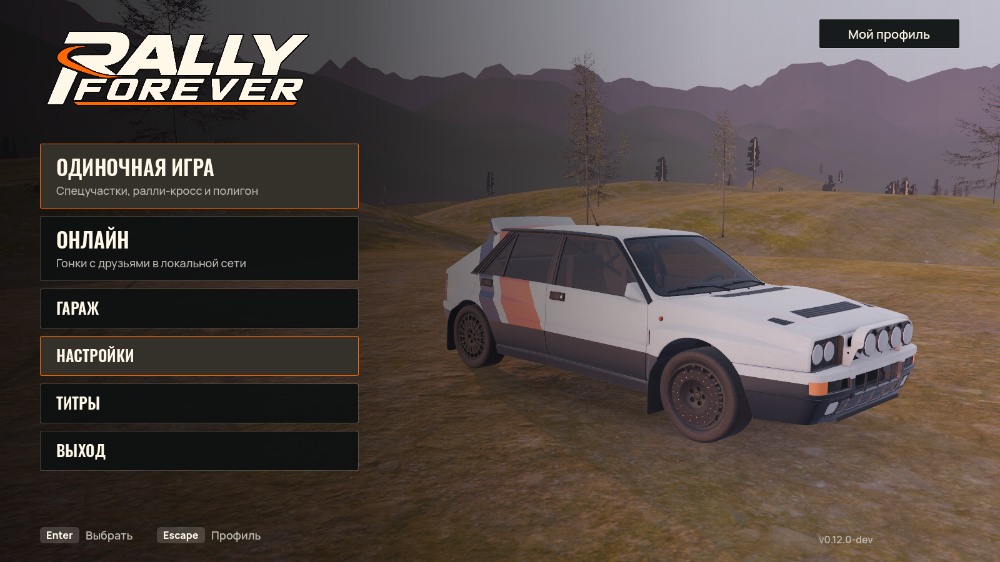

# Rally Forever

Ралли-игра для Windows на Godot: спецучастки на время, ралли-кросс, встречная дуэль, игра по локальной сети и кооператив на одном экране. Проект в разработке.

## Актуальная сборка — 0.15.0-dev

**[Скачать Rally Forever для Windows x64](https://github.com/tenyyq/rally-forever/releases/download/v0.15.0-dev/RallyForever-0.15.0-dev-windows.zip)** · [Описание релиза](https://github.com/tenyyq/rally-forever/releases/tag/v0.15.0-dev)

Распакуйте весь архив и запустите `RallyForever.exe`. Для LAN обоим игрокам нужна одинаковая версия. Лицензии включены в папку `licenses` и в игровые титры.

### Что нового в 0.15

- Общая топология дороги и окружения на всех 18 картах, разделение граней для материалов и коллизий без смещения.
- Исправления старта автомата, обязательные сектора кругов и восстановление без пропуска секторов.
- 2 новых ралли-кросса и 2 встречные дуэли; командная дуэль 2×2 по сумме времён.
- Выбор всех маршрутов через карту регионов, игровые превью, реальные схемы и лучшие карьерные медали.
- Профиль Start/F2, семейства геймпадов, HUD нагрузки, миникарта и коллайдер Фурии HF.
- LOD растительности и 6 новых электронных треков; всего 12 записей с лицензиями.

### Также в текущей версии

- Обновлённые главное меню, профиль, гараж и настройки в цветах логотипа.
- Единственная игровая машина — **Фурия HF**; гараж показывает существующий автомобиль в сцене меню с выбором ракурса.
- Отдельное сцепление, помощь сцепления, переназначение и клавиатурный оверлей.
- Настройки высоты, дистанции и скоростного отдаления камеры, отдельные переключатели HUD.
- Более хаотичная грязь на кузове.
- Карьера: один апгрейд за первое прохождение пары «трасса + машина» без восстановлений. Повторная награда не выдаётся.
- Апгрейды открывают диапазоны отдельных настроек: 15% → 40% → 70% → 100%. Мощность автоматически не увеличивается.
- Онлайн использует отдельные настройки и полный диапазон для всех независимо от карьеры.
- Включены изменения локальной версии 0.12: инфраструктура, рабочие фары, прогресс спецучастка, сетевое ралли с очередью старта и встречная дуэль 1×1.

### Что уже есть

- Гравий, асфальт, грязь и снег; регионы и сезонное оформление с окружением Poly Haven.
- Спецучастки со стенограммой, кольцевые заезды, полигон и сохранённые пользовательские трассы.
- Механическая и автоматическая коробки, дифференциалы, тормоза и главная пара.
- Поддержка геймпада и клавиатуры, локальная сеть, ники и теги.

### Статус проверки

Новый exe собран **без запуска и новых тестов** по выбору владельца. После последней замены общей геометрии игровые проезды не выполнялись. Ранние точечные проверки промежуточных исходников не являются проверкой этого exe.

**Известно:** зимние боты могут вылетать и разбиваться. Полный аудит объектов/дыр и производительности ещё не завершён. Настоящий контроллер, звук на слух и Wi-Fi двух компьютеров не проверены. Сейчас на текущей машине можно получить восемь карьерных апгрейдов, для полного открытия шести настроек нужно 18 — дальнейшая прогрессия зависит от будущего контента.

## Кадры разработки интерфейса

Кадры интерфейса предыдущей версии из Godot; это не фотографии реальных автомобилей и не макеты вместо рабочего UI.

[Ранний трейлер — предыдущие версии, MP4](https://github.com/tenyyq/rally-forever/releases/download/trailer/rally-forever-trailer.mp4)

## Благодарности и лицензии

Участник проекта: [stiiky_](https://github.com/pmnkhn).

Модель автомобиля: [FREE Lancia Delta HF Integrale evo 2](https://sketchfab.com/3d-models/free-lancia-delta-hf-integrale-evo-2-85614131e0dc4613a948472aaa935fc7), автор **TARANTULA (begemot.988888)**, [CC BY 4.0](https://creativecommons.org/licenses/by/4.0/). Изменения: удалены логотипы и номера, изменены ливрея и размеры текстур, адаптированы материалы, колёса, подвеска и свет. Автор не связан с проектом и не заявляет его поддержку.

Окружение: [Poly Haven](https://polyhaven.com/), [CC0](https://polyhaven.com/license); полный список и остальные лицензии находятся в дистрибутиве. Исходный код игры и внутренние инструкции в этом публичном репозитории не публикуются. История предыдущих релизов сохранена в разделе Releases.

Новая музыка: Of Far Different Nature — Rush, Crypt, Another Step Back, Ritual; [альбом](https://fardifferent.bandcamp.com/album/another-step-back), [CC BY 4.0](https://creativecommons.org/licenses/by/4.0/), файлы без изменений, громкость и переходы в игре. Stomper / Ripped Apart — Tricks & Traps, [источник](https://opengameart.org/content/free-rhythm-game-music-pack-2), CC0, конвертация WAV → Ogg Vorbis. Остальные авторы — в дистрибутиве.
